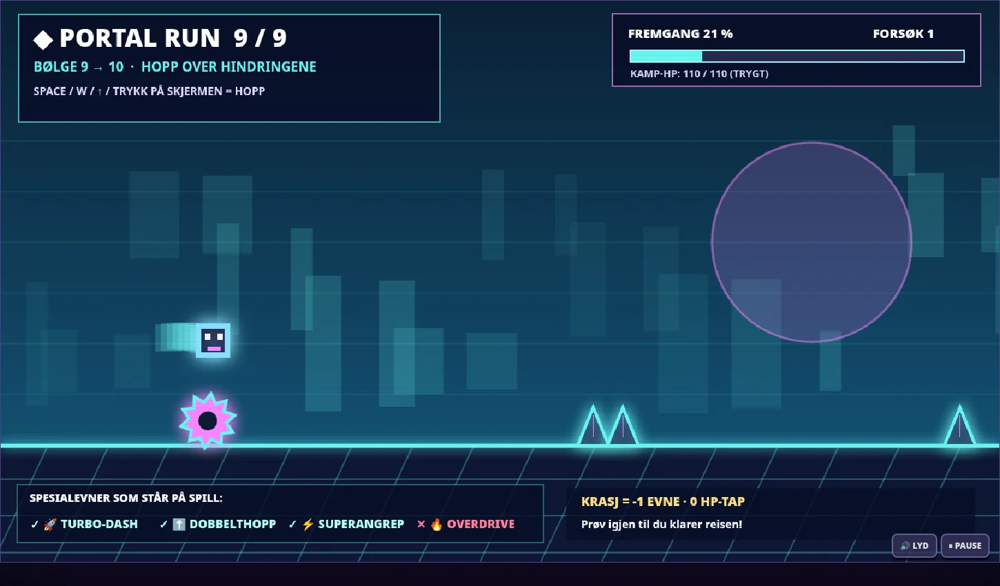

<div align="center">

# 💠 KAOSDUO: PORTAL RUN

### SOLO EDITION · v2.1.0 · PIXEL-ART ACTION + NEON PLATFORMING

**10 combat waves. 9 cube intermissions. 3 bosses. One hero. Every mistake costs a power.**

[](https://darschnid479.github.io/KAOSDuo/play/)
[](https://github.com/Darschnid479/KAOSDuo/releases/tag/v2.1.0)
[](#gameplay)



</div>

## 🎮 About the game

**KAOSDUO: PORTAL RUN** combines retro pixel-art arena survival with a fast auto-running cube platformer. Pick **Blue** ❄️ or **Metal** 🎸 and clear 10 increasingly chaotic enemy waves. Between waves, a portal transforms your selected fighter into a neon cube. Complete the one-button obstacle course to advance to the next combat wave.

**Fail a cube run? You keep all HP, XP and wave progress, but permanently lose ONE of your remaining four special abilities for that game.** Retry as many times as needed. Every portal course can be cleared using only the normal cube jump.

## ✨ Features

- **Single-player only:** one selected character. No second player, no AI partner.
- **10 combat waves**, including three multi-stage bosses: Glitch Warden, Crystal Titan and Portal King.
- **9 different Portal Run intermissions** with spikes, double spikes, blocks, spinning saws, pulse-synced visuals and procedurally generated retro audio.
- **True ability-loss mechanic:** losing a portal attempt disables one available power for the rest of the run; never costs health.
- **4 difficulty levels:** Lett, Medium, Vanskelig and Drit Vanskelig.
- **17 arena upgrades**, score combos, screen effects, double jump, dash and OVERDRIVE.
- **Offline and touch controls:** runs in a modern browser, with Android-style touch controls in the browser. A native Android APK is NOT included in v2.1.

## ⚡ Portal penalties

| Ability | What happens when lost? |
|---|---|
| 🚀 Turbo dash | Dash no longer activates during combat. |
| ⬆ Double jump | Only one jump remains in combat. |
| ⚡ Super attack | Blue/Metal special can no longer fire. |
| 🔥 OVERDRIVE | Rage/OVERDRIVE mode can no longer activate. |

The ability removed at each collision is randomly selected from powers you still have. Once all four are gone, retrying remains possible. There is no health penalty in the portal mode.

## ⌨ Controls

| | In combat | In Portal Run |
|---|---|---|
| Move | A / D or ← / → | Cube moves automatically |
| Jump | W / ↑ | Space / W / ↑ / tap screen |
| Shoot | F or K | — |
| Dash | Shift or Q | — |
| Super | G or L | — |
| Pause | P or Escape | P or Escape |
| Audio | M | M |
| Retry | Main menu | Enter / Space / Retry button |

On touch devices, the arena has movement/attack buttons and Portal Run has a separate big JUMP button.

## 📦 Installation

**Recommended offline download:** [KAOSDUO_PORTAL_RUN_v2.1.0.html](https://github.com/Darschnid479/KAOSDuo/releases/download/v2.1.0/KAOSDUO_PORTAL_RUN_v2.1.0.html). Double-click to open in Chrome, Edge or Firefox. All assets are embedded; no installation or internet connection required.

Alternatively download the [complete offline ZIP](https://github.com/Darschnid479/KAOSDuo/releases/download/v2.1.0/KAOSDUO_PORTAL_RUN_v2.1.0_OFFLINE.zip).

**Web play:** `play/index.html` (requires `assets/blue.webp` and `assets/metal.webp`). The GitHub Pages site requires Pages deployment to be enabled by the repository owner.

**Android note:** Earlier Android builds had startup issues and are not part of this release. Do not mistake the older APK for a 2.1 port.

## 📷 Screenshots

| Portal Run gameplay | Character selection |
|---|---|
|  |  |

## 🗂 Project structure

```text
/
├─ index.html                  # Public landing page
├─ play/index.html             # In-browser game
├─ assets/                     # Site art, characters and CSS
├─ dist/                       # Standalone offline HTML and ZIP
├─ PORTAL_RUN_GUIDE.md         # Game guide
├─ CHANGELOG.md
└─ .github/workflows/          # Pages and release workflows
```

## 🧪 Verification

Portal collision, all nine transitions, HP preservation, ability removal, pause/resume and mobile touch controls were exercised with automated Chromium testing. The 9 courses were also completed in a gameplay simulation at all four difficulty levels (36 course completions). No claim is made that an Android APK was tested or released for v2.1.

---

Built by [Darschnid](https://github.com/Darschnid479). Not affiliated with Geometry Dash or its creators.