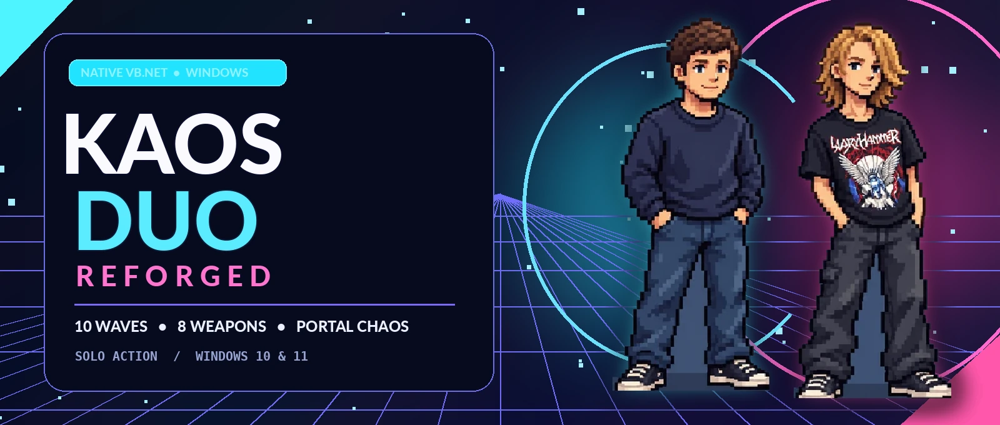
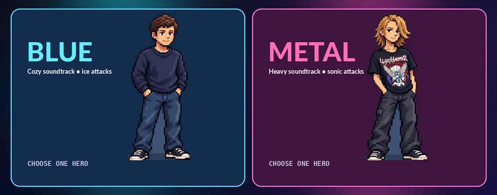
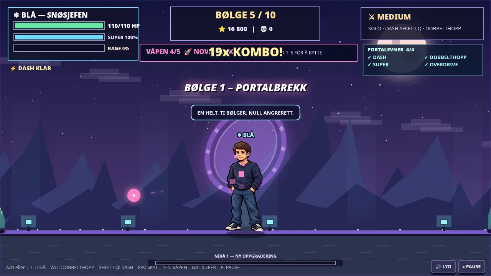
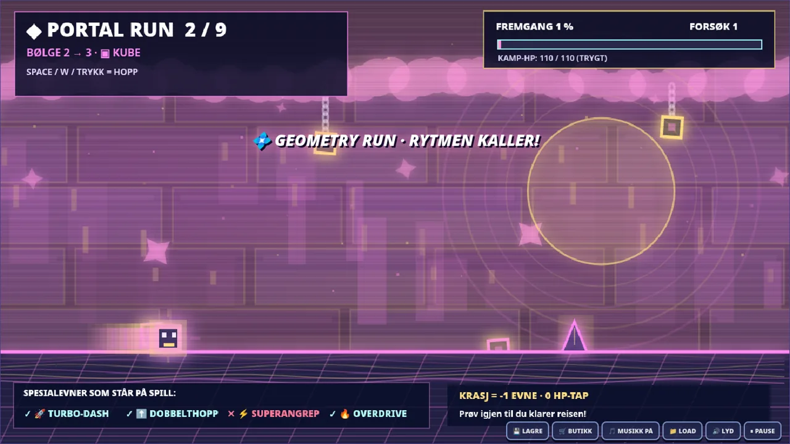
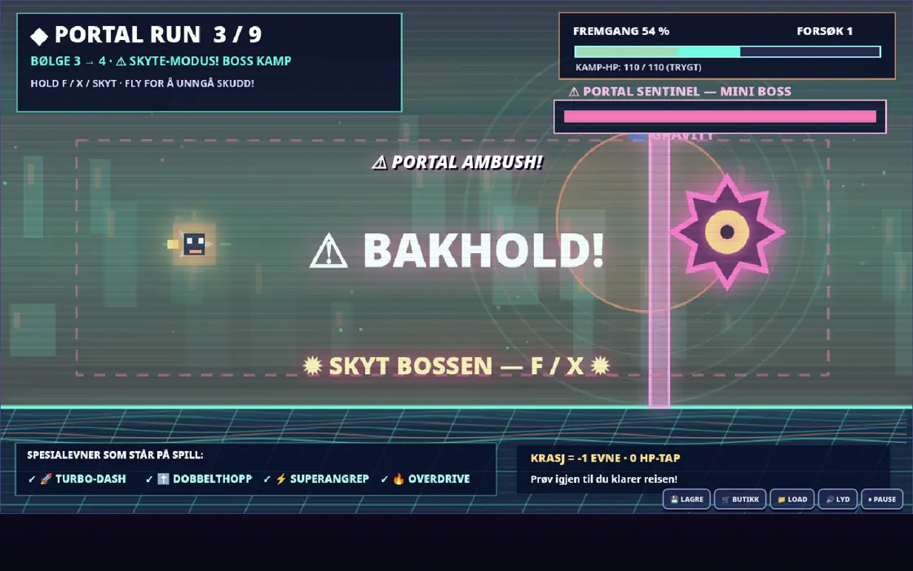

<div align="center">
  

  # KAOSDUO: REFORGED

  **One hero. Ten waves. Nine unpredictable portal journeys. Absolute chaos.**

  A **solo pixel-art action game for Windows**, built with a native **Visual Basic .NET** game engine.
  Fight monsters, unlock new weapons, survive neon portals and reach the final boss.

  [](https://github.com/Darschnid479/KAOSDuo/releases/latest)
  [](src/KAOSDUO.VB/)
  [](https://github.com/Darschnid479/KAOSDuo/releases/tag/v6.0.0)
  [](#choose-your-hero)

  **[DOWNLOAD WINDOWS GAME](https://github.com/Darschnid479/KAOSDuo/releases/download/v6.0.0/KAOSDUO_REFORGED_v6.0.0_WIN64.zip)** · **[VIEW LATEST RELEASE](https://github.com/Darschnid479/KAOSDuo/releases/tag/v6.0.0)** · **[SOURCE CODE](src/KAOSDUO.VB/)**
</div>

---

## The game

A portal experiment has gone catastrophically wrong. Monsters pour into the world, reality glitches between dimensions, and every victory pushes you toward another unpredictable challenge.

Choose **Blue** or **Metal** and fight your way through **10 combat waves**. Defeating enemies earns coins for an **eight-weapon armory**. Between waves, the game sends you into one of two challenges: a neon obstacle course with jumping, flight and gravity changes, or a high-speed, three-lane **Neon Highway**. You never know which route comes next.

And some portal runs have an extra surprise: a shooting miniboss can interrupt your journey. You can **move, aim and shoot** during the fight, then resume the portal. If you crash in a travel section, you lose a special ability—not combat HP.

## Choose your hero

<div align="center">
  
</div>

| ❄️ Blue | 🎸 Metal |
|:--|:--|
| Ice-flavored attacks and a calm, cozy soundtrack | Sonic-powered attacks and an original heavy-metal soundtrack |
| Same solo campaign, different style | Same solo campaign, different style |

## Game features

| Combat & progression | Portal chaos | Quality of life |
|:--|:--|:--|
| 10 combat waves and multiple bosses | 50% Geometry Portal / 50% Neon Highway per journey | Automatic and manual save/load |
| 8 unlockable, visible weapons | Cube jumps, ship flight and gravity flips | 4 difficulties: Easy, Medium, Hard, Brutal |
| Earn coins and buy weapons in the shop | 25% miniboss chance on Geometry Portal runs | Original music for each character |
| Animated sprites, recoil and muzzle-origin shots | Free movement while shooting the portal miniboss | F12 screenshots and adjustable audio |
| Combo bonuses, reload and OVERDRIVE | 3-lane driving, nitro and collectibles | One player; no AI teammate |

## Gallery

> **Visual note:** The gameplay screenshots below are from the **earlier browser editions (v4–v5)**, included to illustrate the combat, shop and portal concepts. The **current v6.0 native VB.NET version has a different renderer**. The character illustrations above are the original artwork used by the project; native Windows screenshots will be added after a full visual playtest.

<table>
  <tr>
    <td width="50%"><br/><b>Combat and weapons</b> — browser prototype</td>
    <td width="50%"><br/><b>Weapon armory</b> — browser prototype</td>
  </tr>
  <tr>
    <td><br/><b>Geometry Portal</b> — browser prototype</td>
    <td><br/><b>Neon Highway</b> — browser prototype</td>
  </tr>
  <tr>
    <td colspan="2"><br/><b>Surprise portal boss</b> — browser prototype</td>
  </tr>
</table>

## Download & play

**Latest native Windows release:** [**KAOSDUO: REFORGED v6.0.0**](https://github.com/Darschnid479/KAOSDuo/releases/tag/v6.0.0)

1. Download [`KAOSDUO_REFORGED_v6.0.0_WIN64.zip`](https://github.com/Darschnid479/KAOSDuo/releases/download/v6.0.0/KAOSDUO_REFORGED_v6.0.0_WIN64.zip).
2. Extract the ZIP to a folder (don't run the executable from inside the ZIP).
3. Start **`KAOSDUO.exe`** on **Windows 10/11, 64-bit**.

The Windows package includes its .NET runtime. No additional .NET installation is needed to play. For the editable VB.NET project, download [the source ZIP](https://github.com/Darschnid479/KAOSDuo/releases/download/v6.0.0/KAOSDUO_REFORGED_v6.0.0_SOURCE.zip).

> **Build status:** The native Windows package was compiled successfully in GitHub Actions. A complete hands-on playtest across Windows configurations is still pending. Please [report issues](https://github.com/Darschnid479/KAOSDuo/issues) with the game version and steps to reproduce.

## Controls

| Action | Keys |
|:--|:--|
| Move / jump | `A`, `D`, arrows / `W`, `Space` |
| Aim and fire | Mouse / left-click or `F` (auto-target) |
| Dash / Super / OVERDRIVE | `Shift` / `G` / `Q` |
| Reload / switch weapons | `R` / `1`–`8`, mouse wheel, `Tab` |
| Shop / save / load | `B` / `F5` / `F9` |
| Portal boss movement | **WASD / arrows**, move freely while aiming |
| Geometry portal | `Space` or `W`: jump, hold to fly, tap to flip gravity |
| Neon Highway | `A` / `D` to change lanes, hold `Space` for nitro |
| Pause / music / fullscreen | `P` or `Esc` / `M` / `F11` |
| Capture screenshot | `F12` |

## Built in Visual Basic .NET

**KAOSDUO: REFORGED is a native Windows game**, not an HTML game inside a WebView. Gameplay logic, rendering, input and collision handling are implemented in **VB.NET + Windows Forms / GDI+**.

Project structure:

```text
src/KAOSDUO.VB/
  GameForm.vb          Game loop, input, UI and save/load
  Simulation.vb        Combat, enemies, portals and collisions
  RenderScenes.vb      Visuals and character animations
  RenderHelpers.vb     Drawing utilities
  GameData.vb          Models, weapons, game rules
  MusicPlayer.vb       Blue / Metal original soundtracks
  Assets/              Character art and music
BUILD_WINDOWS.bat      Build for Windows
```

**To build from source:** install the .NET SDK 8 or newer, then run `BUILD_WINDOWS.bat` on Windows. See the [v6 source release](https://github.com/Darschnid479/KAOSDuo/releases/tag/v6.0.0).

### Saves and compatibility

Native saves are stored in `%APPDATA%\KAOSDUO\save_v6.json`. Saves from earlier HTML versions are **not compatible** with the native engine. The [previous releases](https://github.com/Darschnid479/KAOSDuo/releases) remain available separately.

### Project status and platforms

- **Windows x64:** native v6.0.0 release available.
- **Web:** archived legacy versions available in Releases; not the v6 native engine.
- **Android:** no supported v6 Android APK; earlier experimental builds are separate.

*KAOSDUO is an original independent project. Its Geometry-style mode uses original code and assets, not assets from Geometry Dash.*

<div align="center">
  <sub>Made for big combos, ridiculous bosses and one more portal run. ⚡</sub>
</div>
