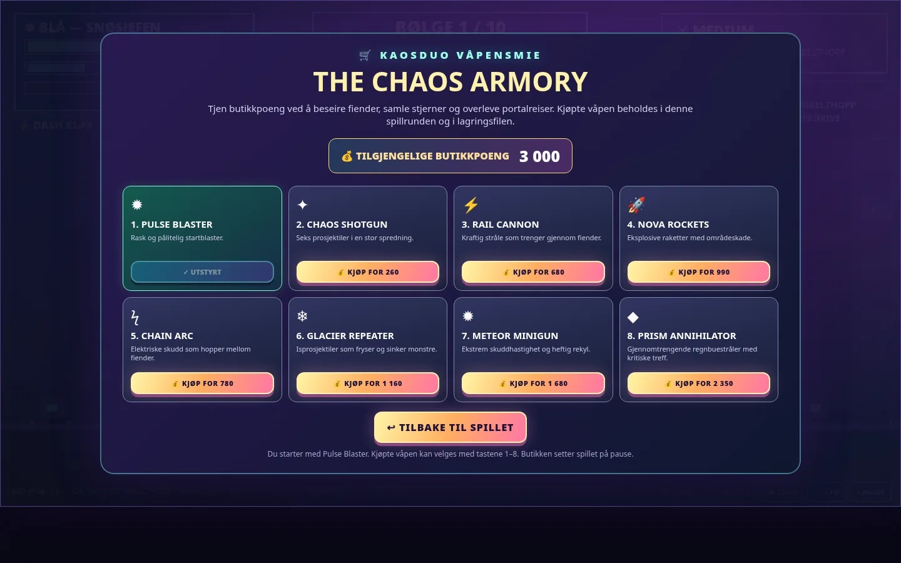

# ⚡ KAOSDUO: PORTAL AMBUSH v4.2.0

**A pixel-art solo action game with ten combat waves, nine Portal Runs, eight unlockable weapons and two original character themes.**

[▶ Play online](https://darschnid479.github.io/KAOSDuo/play/) · [⬇ Download v4.2.0](https://github.com/Darschnid479/KAOSDuo/releases/tag/v4.2.0) · [Source code](https://github.com/Darschnid479/KAOSDuo)

> GitHub Pages needs to be enabled in repository settings before the online links work. The release HTML can be opened directly in a browser offline.

## 🎮 What you can do

- **Solo:** Pick **❄️ Blue** or **🎸 Metal**. Four difficulties: Lett, Medium, Vanskelig and Drit Vanskelig.
- **Fight:** Ten waves with three bosses and 17 character upgrades.
- **Portal Run:** Nine neon transitions combining cube jumps, ship flying and gravity changes. Each portal independently has a **25% chance** for an unannounced, sudden shooting miniboss phase **in the middle of the run**. Defeat it, then continue the same portal. Losing a portal attempt removes a special ability, **not HP**.
- **Armory:** Earn coins from monster kills and portal journeys. **After every cleared battle wave, the game asks whether you want to buy a weapon** before entering the next portal. You can buy or skip. Begin with Pulse Blaster, buy seven other guns with your earnings, and equip any owned weapon with keys **1–8**.
- **Save / Load:** Manual and automatic checkpoints, including character, difficulty, HP, XP, score, shop currency, weapons, upgrades, abilities and Portal Run state. Export/import `.json` backups to move progress between browsers.
- **Original soundtrack:** Metal has fast distorted synthetic guitar riffs; Blue has calm cozy arpeggios. Music is generated with the Web Audio API, without external music files.

## 🔫 Weapon prices

| Weapon | Cost (shop points) | Ability |
| --- | ---: | --- |
| Pulse Blaster | Free | Balanced starter |
| Chaos Shotgun | 260 | Six pellets |
| Rail Cannon | 680 | Piercing shots |
| Chain Arc | 780 | Chaining electricity |
| Nova Rockets | 990 | Explosive splash damage |
| Glacier Repeater | 1,160 | Freezing rapid shots |
| Meteor Minigun | 1,680 | High rate of fire |
| Prism Annihilator | 2,350 | Piercing prismatic blasts |

## Controls

| Action | Key |
| --- | --- |
| Move / Jump | A / D / W |
| Shoot / Special / Dash | F / G / Shift |
| Equip purchased weapon | 1–8 |
| Open Armory | B |
| Save / Load menu | L |
| Pause / Music | P / M |
| Portal cube | Tap to jump |
| Portal ship | Hold action to fly |
| Portal gravity | Tap to flip |
| Portal boss | F or X to shoot |

## Save system

Manual and auto saves use your browser's local storage and are separate slots. Autosaves occur at the start of each wave, at the start of portal runs, and after portal penalties. Shop purchases also trigger autosave. Export a backup from the Save / Load panel if you want to transfer progress or keep a backup. Browsers may isolate file-based pages and block local storage: JSON export/import is provided as an alternative.

## Installation

Download the self-contained `.html` file from **Releases** and open it in Chrome or Edge. No installation or network access is required. The Android v1.1 beta is a separate, older, unverified build.

## Notes

The game includes strong animated neon light effects. All character music is newly composed via code, not existing copyrighted recordings.

## v4.2.0: Surprise portal ambush & automatic weapon offer

- **25% per portal**, selected once when the portal starts; the encounter is hidden until it actually interrupts the level around the middle. Failure/retry does not reroll the encounter.
- The run pauses for an actual **shooting phase**. You keep flight controls and shoot the mini boss with **F / X**; defeating it resumes the course at the interruption point.
- Portal levels alternate the order of **ship and gravity sections**, rather than repeating an identical sequence.
- **Coin shop offer** appears automatically after every combat wave (except the final victory). Choose **Yes** to browse/buy and **No** to continue to the portal. The offer and purchases are saved.
- Old v4.1 saves remain loadable through the original manual and auto save slots.
