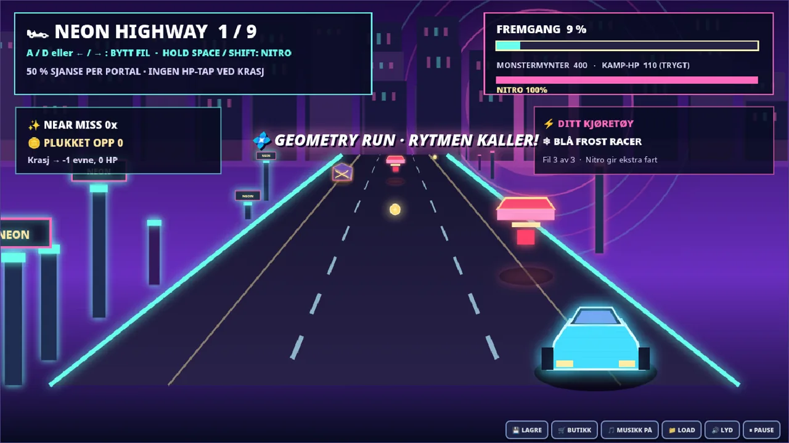

# 🏎️ KAOSDUO: NEON HIGHWAY v5.0.0

**Two heroes. One player. Ten combat waves. Nine unpredictable intermissions.**

**[Download v5.0.0](https://github.com/Darschnid479/KAOSDuo/releases/tag/v5.0.0)** · **[Play in browser*](https://darschnid479.github.io/KAOSDuo/play/)** · **[Repository](https://github.com/Darschnid479/KAOSDuo)**

> **Website:** The browser link requires GitHub Pages to be enabled in repository settings. The release HTML is completely self-contained and works offline without Pages.

## 🚀 What's new in 5.0

After each monster wave (except the final one) you pass through one of two **randomly selected travel modes**, chosen independently for each intermission:

| Probability | Travel mode | Gameplay |
| --- | --- | --- |
| **50%** | 🏎️ **Neon Highway** | Drive a colorful perspective/pseudo-3D car through three lanes of traffic hazards; steer with A/D or arrows, use rechargeable nitro with Space/Shift, collect coins and earn near-miss bonuses. |
| **50%** | 💠 **Geometry Run** | A colorful platforming portal with animated geometric scenery, cube jumps, flying sections, gravity flips and **25% chance of a sudden shooting mini-boss** halfway through the geometry course. |

**No portal or highway crash takes any HP.** Each failed travel attempt costs one *remaining* special ability (dash, double jump, special attack or OVERDRIVE). You can retry an unlimited number of times and continue after clearing the route. Both modes support mouse/keyboard and mobile touch controls.

### 🎸 Original character music — now actual audio

- **Metal:** *Infernal Riff* — original heavy, riff-driven instrumental with synthesized distorted power chords, bass, drums and cymbals, available in `assets/metal_theme.mp3`.
- **Blue:** *Cozy Fjord* — original gentle bells, pads, arpeggios and soft bass, available in `assets/blue_theme.mp3`.
- Music plays from a real MP3 loop when you click **Start**, and the menu has a **🎧 HØR VALGT MUSIKK** audition button. The Web Audio synthesizer remains as a fallback.
- Soundtracks are original procedural compositions rendered to MP3, not sampled commercial recordings.

### 🔫 Still included

- **100% solo**, choose Blue or Metal; **Lett, Medium, Vanskelig, Drit Vanskelig**.
- **10 combat waves**, **3 major bosses**, **8 unlockable weapons**, character skill upgrades.
- Earn **shop coins** by killing monsters, completing portal journeys, collecting road coins and making near misses.
- After each wave the game asks if you want to **buy weapons before travelling**. Open or skip the Armory.
- **Manual / auto Save/Load**, including purchased weapons, abilities, stage, credits and the new road-mode state. JSON export/import. The same v4.1/v4.2 save keys are retained for backward compatibility.
- **25% miniboss** probability is conditional on Geometry Run (the highway replaces that portal, not the combat wave).

## 🎮 Controls

| Mode | Controls |
| --- | --- |
| Combat | A / D move · W jump · F shoot · G special · Shift/Q dash · 1–8 equipped weapons · B shop |
| Geometry cube | Space/W/↑/tap = jump |
| Geometry spaceship | Hold Space/W/↑/ACTION = fly up; release to descend |
| Geometry gravity | Space/W/↑/tap = reverse gravity |
| Geometry miniboss | F / X to fire; fly to dodge enemy bullets |
| Neon Highway car | **A/D or ←/→** = change lane · **Space or Shift** = hold nitro; recharge by releasing |
| Mobile highway | On-screen ◀ **VENSTRE**, ⚡ **NITRO**, **HØYRE** ▶ |
| Game menus | P pause · B armory · L save/load · M mute · 🎵 music toggle |

## 💾 Save/Load and older saves

The game preserves the localStorage slot names from v4.1 (`kaosduo_v41_manual` and `kaosduo_v41_auto`) so earlier saves are not discarded. Existing geometry runner saves are migrated to the correct `geometry` variant. New highway saves serialize road position, lane, pickups, obstacles, nitro and progress. As with browser-local saves in general, an HTML file opened from a new origin/location may see a different storage area; use **Export/Import JSON** to transfer saves.

## 📥 Install

1. Download `KAOSDUO_NEON_HIGHWAY_v5.0.0.html` from [the release](https://github.com/Darschnid479/KAOSDuo/releases/tag/v5.0.0).
2. Open the file in Chrome, Edge or another modern browser. No network connection needed.
3. Choose Blue or Metal, try **HØR VALGT MUSIKK**, and press **Start**. Make sure your device's media volume is turned up.

The full ZIP contains the standalone game, editable web sources, MP3 soundtrack files, graphics and documentation. The earlier Android APK is not this version and remains unverified on real Android hardware.

## ⚠️ Accessibility / notes

The game includes frequent flashing effects, fast-changing light, motion and intense color transitions. If you're light-sensitive, enable your operating system's **Reduce Motion** option where available and avoid the intense scenes. This is an original game and not affiliated with Geometry Dash.

Built by [Darschnid](https://github.com/Darschnid479). ❤️
