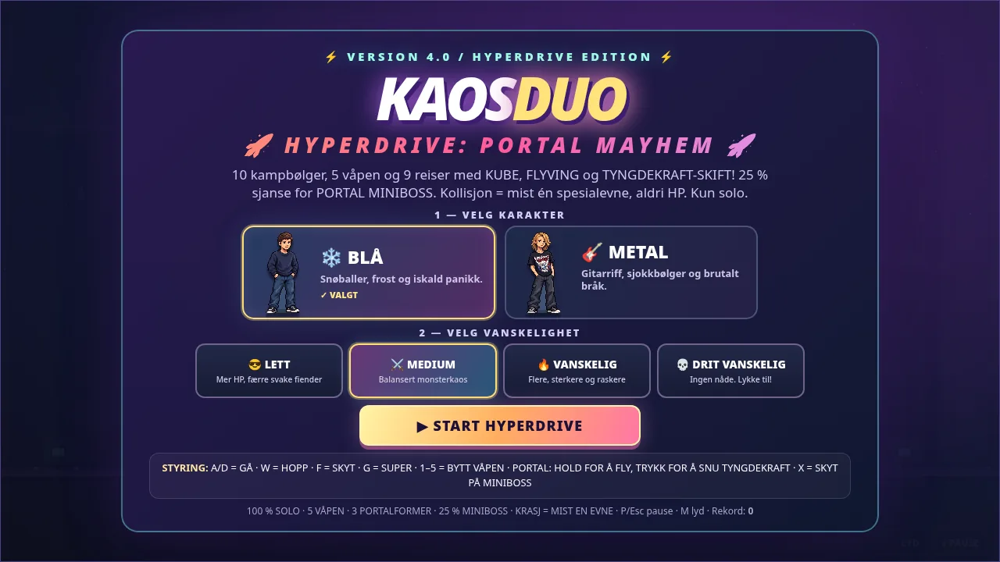
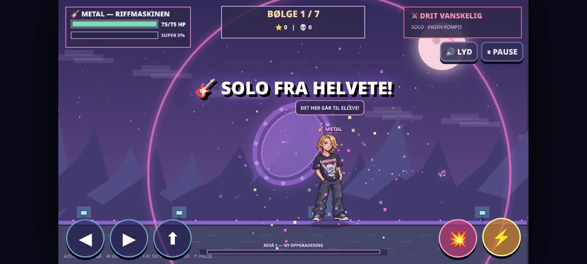

<div align="center">

# ⚡ KAOSDUO: PORTALPANIKK!

### SOLO EDITION · A PIXEL-ART SURVIVAL GAME

**Two heroes. One player. Seven waves of absolute chaos.**

[](https://darschnid479.github.io/KAOSDuo/play/)
[](https://darschnid479.github.io/KAOSDuo/)
[](#downloads)



</div>

## 🎮 About

**KAOSDUO: PORTALPANIKK!** is a fast, chaotic 2D survival game. A mysterious portal is spilling slime monsters into the world, and it's up to **one** character to stop them. Select your fighter, choose your difficulty, survive seven waves and defeat the final boss.

> **Solo means solo:** one playable character at a time — no split-screen, no second player and no AI companion.

## ✨ Features

- ❄️ **Two selectable characters:** Blue and Metal, each with their own attacks.
- ⚔️ **Four difficulty settings:** Lett, Medium, Vanskelig and Drit Vanskelig.
- 👾 **Seven waves** of increasingly dangerous enemies, ending in a boss battle.
- 💥 **Special attacks** with unique visual and audio effects.
- ⭐ **XP and upgrades** to improve your chances of survival.
- 🏆 **High scores** and replayable arcade-style gameplay.
- 🕹️ **Keyboard and on-screen controls.**
- 🌐 **Playable in your browser** with no account or external dependencies.

## 👥 Playable characters

| ❄️ BLUE | 🎸 METAL |
|:---:|:---:|
|  |  |
| Snowballs, frost and freezing attacks | Music projectiles, electric riffs and guitar solo |

## 💀 Difficulty modes

| Mode | Starting HP | What to expect |
| --- | ---: | --- |
| 😎 **Lett** | 150 | More health and fewer weak enemies |
| ⚔️ **Medium** | 110 | Balanced difficulty |
| 🔥 **Vanskelig** | 90 | Faster, stronger and more numerous enemies |
| 💀 **Drit Vanskelig** | 75 | Brutal enemy pressure. Good luck. |

## 📸 Screenshots

<div align="center">
  
</div>

## 🚀 Play / Download

### Browser (recommended)

[**▶ Play KAOSDUO Solo Edition**](https://darschnid479.github.io/KAOSDuo/play/) or download the repository and open `play/index.html` locally. The original game logic is retained; character images are loaded as separate, optimised WebP assets.

### Android beta

[**Download Android v1.1 test build (APK) from Google Drive**](https://drive.google.com/file/d/1fIBhNqrxIuV92PWYR7HwfB6j1To7IiFs/view)

> ⚠️ **Experimental Android build.** The Android APK is not verified on a physical device; previous builds exited on startup. Treat v1.1 as a test release, not as a stable launch. Browser is currently the recommended way to play.

## ⌨️ Controls

| Action | Keyboard |
| --- | --- |
| Move | `A` / `D` or `←` / `→` |
| Jump | `W` or `↑` |
| Shoot | `F` or `K` |
| Super attack | `G` or `L` |
| Pause | `P` or `Esc` |
| Mute | `M` |

## 🗂️ Project structure

```text
KAOSDuo/
├── index.html                 # Official promotional website
├── play/
│   └── index.html            # Full browser game, solo edition
├── assets/
│   ├── blue.webp             # Original character, optimised
│   ├── metal.webp            # Original character, optimised
│   ├── gameplay.webp         # In-game screenshot
│   ├── menu.webp             # Game-menu screenshot
│   ├── site.css              # Responsive website styling
│   ├── site.js               # Website navigation and animations
│   └── icon.svg              # Site icon
└── .github/workflows/
    └── pages.yml             # Automatic GitHub Pages publishing
```

## 🛠️ Development

The website and browser game are static HTML, CSS and JavaScript. No package manager, build command, backend or analytics are required. To run locally, open `index.html` or use a local HTTP server such as `python -m http.server 8000` and browse to `http://localhost:8000`.

This repository contains the **browser game and project website**. The Android APK is distributed separately as an experimental test build.

## 🙌 Credits

Created by **[Darschnid](https://github.com/Darschnid479)**. The two playable characters are based on the original pixel-art character illustration supplied for the project.

---

<div align="center">
  <strong>ONE HERO. ZERO BACKUP. 100% CHAOS.</strong><br><br>
  <a href="https://darschnid479.github.io/KAOSDuo/">Website</a> · <a href="https://darschnid479.github.io/KAOSDuo/play/">Play</a> · <a href="https://github.com/Darschnid479/KAOSDuo/issues">Report an issue</a>
</div>