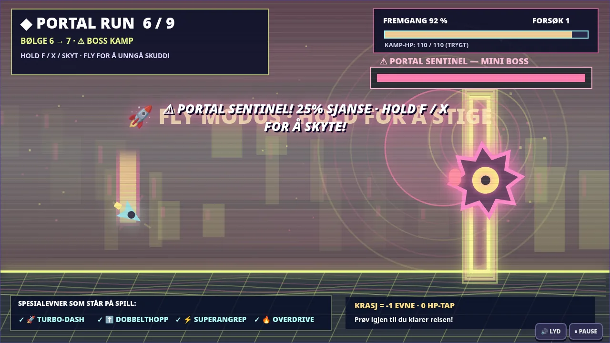
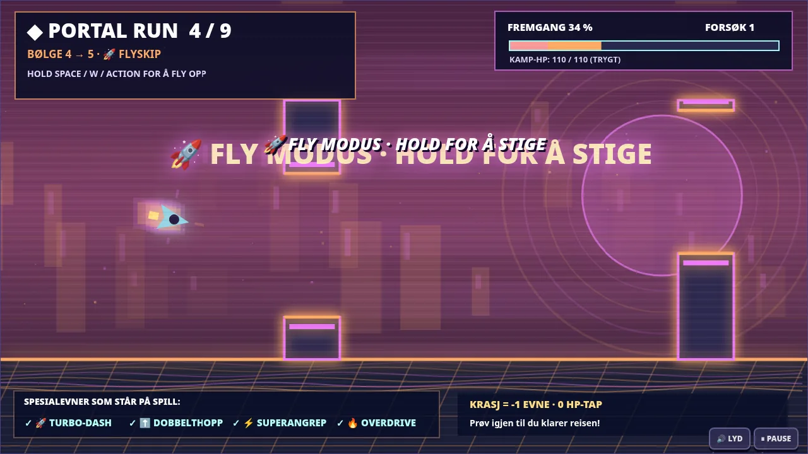

# KAOSDUO: HYPERDRIVE v4.0.0

The most intense KAOSDUO yet: **five combat weapons**, **three portal transformation modes**, and a **25% mini-boss encounter chance for each of the nine portals**.

### Combat
- Switch on the fly with 1–5: Pulse Blaster, Chaos Shotgun, Rail Cannon (piercing), Nova Rockets (splash), Chain Arc (chain lightning).
- Original character select, 4 difficulties and all 10 waves remain available.
- Enhanced impact feedback and combo effects.

### Portals
- **CUBE:** timed jumps over neon spikes.
- **SHIP:** hold W/Space to fly through laser gaps.
- **GRAVITY:** tap to reverse gravity and dodge floor/ceiling hazards.
- **PORTAL SENTINEL:** each portal independently has 25% chance to spawn a miniboss. Hover to dodge and use F/X to fire at it. Boss HP is local to the portal; entering the encounter does not affect combat HP.
- Crashes cost **one remaining special ability**, never HP. Unlimited retries. Bonus score for miniboss victory.

### Files
- KAOSDUO_HYPERDRIVE_v4.0.0.html: standalone offline PC/browser game.
- KAOSDUO_HYPERDRIVE_v4.0.0_OFFLINE.zip: full offline game and instructions.

**Heads-up:** flashing lights and rapid color changes; this is a PC/browser release, not an updated Android APK.

## Screenshots

